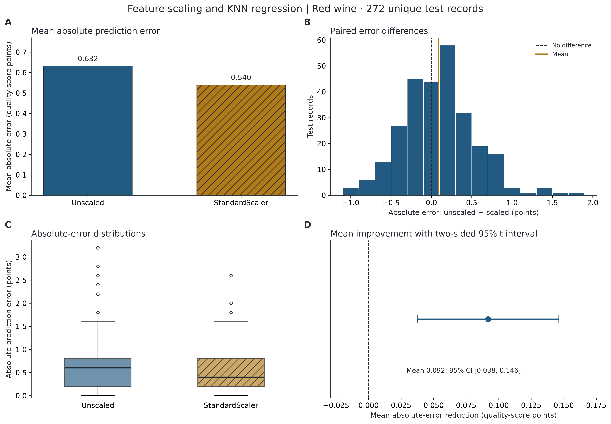

# Does feature scaling improve KNN wine-quality regression?

A reproducible statistics-course experiment comparing identical KNN regressors
with and without StandardScaler on UCI Wine Quality. Red wine is the primary
analysis; white wine is a separate secondary replication. No tuning or seed search.

## Observed results

After removing 240 exact red duplicates **before** the split, 1,359 unique records
yield 1,087 training and 272 test wines (seed 42).

| Primary red experiment | Unscaled | StandardScaler |
| --- | ---: | ---: |
| MAE | 0.631618 | 0.539706 |
| RMSE | 0.821852 | 0.712906 |

For d = absolute error(unscaled) − absolute error(scaled), mean d = **0.091912**
quality-score points (14.55% of control MAE), t(271) = **3.335149**, one-sided
p = **0.000485786**, two-sided 95% CI **[0.037656, 0.146168]**, observed Cohen's
dz = **0.202223**. Reject H0: μd ≤ 0 at α=.05 for this prespecified comparison.
This supports an MAE benefit for these fixed models and split; it does not
establish benefit for all wines or new training sets. Unknown wine/batch
dependence remains a limitation. Differences are discrete and not exactly normal;
the paired bootstrap interval [0.038235, 0.145588] is a descriptive sensitivity check.

The a priori paired t-test calculation assumed dz=.20, α=.05, power=.80 and
alternative='larger', requiring **156 pairs** (unrounded: 155.9257). The red
test set is sufficient under those assumptions, with design power .9501.
The assumed dz was fixed before evaluation; it is not estimated from test errors.

White wine: 4,898 raw records → 3,961 unique records, 3,168 train / 793 test.
MAE 0.691299 → 0.602774; mean d=.088525, t(792)=5.124467,
one-sided p=1.87593e-7. This is secondary evidence; no pooling or claim of
independent collection is made.

Read the [full statistical report](reports/statistical_report.md) and the
[plan recorded before evaluation](reports/analysis_plan.md).



## Reproduce from a clean checkout

Use **CPython 3.13 (64-bit)**. The exact dependency set is pinned in
`requirements.txt`, including transitive packages and pytest. The reference
run used Python 3.13.15 on Windows. Other platforms may have small numerical or
rendering differences; neighbor-distance ties can depend on numerical libraries.
Internet access is needed for package installation; experiment inputs are local.
Do not use the Python package named `sklearn`; the dependency is `scikit-learn`.

Windows PowerShell (activation is unnecessary):

```powershell
git clone https://github.com/Seiitsu77/AIPI510-Project2.git
cd AIPI510-Project2
# While the implementation PR is under review:
git switch experiment/knn-feature-scaling
python -m venv .venv
.\.venv\Scripts\python.exe -m pip install -r requirements.txt
.\.venv\Scripts\python.exe scripts/run_experiment.py --dataset both --stage prepare
# Inspect results/red/power_plan.json and reports/analysis_plan.md first.
.\.venv\Scripts\python.exe scripts/run_experiment.py --dataset both --stage evaluate
.\.venv\Scripts\python.exe -m pytest -q
```

macOS/Linux with Python 3.13 installed:

```bash
python3.13 -m venv .venv
.venv/bin/python -m pip install -r requirements.txt
.venv/bin/python scripts/run_experiment.py --dataset both --stage prepare
.venv/bin/python scripts/run_experiment.py --dataset both --stage evaluate
.venv/bin/python -m pytest -q
```

Red only: `python scripts/run_experiment.py` (using the virtual-environment Python).
Both cohorts in one command: `python scripts/run_experiment.py --dataset both`.
`--stage all` still persists power plans for all requested cohorts before
evaluating either. To regenerate into a new folder without changing the saved
reference results, add `--output-dir .tmp/reproduction`. Raw inputs and the
analysis plan are always read from this repository, independent of working directory.

On a fresh output directory, preparation creates cleaned data, duplicate maps,
fixed memberships and power plans. With matching existing plans it preserves
the original planning time and does not silently replace inputs. Evaluation
verifies the input, split and power hashes. Changed inputs/design require a new
output directory and documented plan amendment. Running again is reproduction,
not a new independent experiment. Manifests contain run-specific event times;
SVG metadata/identifiers may differ while statistics and predictions agree.
Generated CSV/JSON files use LF newlines on every platform so their recorded
hashes survive Git checkout. Raw source files retain their original bytes.

In a restricted Windows sandbox with an unwritable default temporary directory,
create `.tmp` and set `TEMP` and `TMP` to its absolute path before creating the
virtual environment. The runner keeps Matplotlib's cache under `.tmp/matplotlib`;
pytest uses `.tmp/pytest`. Neither cache is tracked.

## Repository layout

```text
data/
  raw/                     # immutable supplied semicolon CSVs and .names
  cleaned/                 # deduplicated CSVs with representative source IDs
src/wine_scaling/
  config.py                # fixed seed, model, power and bootstrap settings
  data.py                  # schema, numeric and duplicate validation
  power.py                 # statsmodels a priori paired t-test planning
  models.py                # identical KNN arms; treatment-only scaler pipeline
  statistics.py            # paired t-test, intervals, dz and diagnostics
  plots.py                 # publication-quality figures
  reporting.py             # report built from saved results
  experiment.py            # preparation, evaluation and provenance
  io.py                    # hashes and JSON artifacts
scripts/run_experiment.py  # CLI, no notebook required
results/{red,white}/       # numeric evidence and provenance
figures/{red,white}/       # 300 dpi PNG and editable/vector SVG
reports/                  # prospective plan and generated statistical report
tests/                    # leakage, reconstruction, direction and integrity checks
.github/                  # CI and pull request template
requirements.txt          # exact environment dependencies
CONTRIBUTING.md            # branch and review workflow
```

## Inspect the saved evidence

Each cohort's `results/` directory contains:

- `predictions.csv`: one row per test wine, its source ID, 11 features, true quality,
  predictions, both absolute errors, and their signed paired difference.
- `metrics.csv` and `inference.json`: full-precision MAE/RMSE, test statistic, df,
  one-sided p, two-sided 95% CI, one-sided lower bound, observed dz, descriptive
  diagnostics and prespecified bootstrap interval.
- `split_membership.csv`: source IDs and order within the training/test split.
- `duplicate_map.csv`: all original record IDs and the retained representative.
- `data_audit.json`: row counts, missingness, predictor summaries and quality counts.
- `power_plan.json` and `prepared_design.json`: assumed power inputs, planned n,
  preparation time and hashes checked before evaluation.
- `scaler_training_statistics.json`: feature means, variances, scales and number of
  training records seen, allowing a direct check that no test rows fit the scaler.
- `evaluation_manifest.json`: input/plan/source/output hashes, code commit at run,
  timestamps, software versions and interpretation scope. The run-time commit
  is provenance; source hashes also cover files that were not yet committed.

Figures include all four requested comparisons individually, a four-panel summary,
and a normal Q–Q diagnostic for each cohort. Use SVG for resizing and editing,
or the 300 dpi PNG for slides. The interval chart displays uncertainty about the
paired mean; the boxplot displays observation spread. No Wilcoxon p-value is
reported because symmetry/location-shift assumptions are unestablished.

## Validity and collaboration

The single primary hypothesis is tested on paired **absolute errors**, not quality
labels, RMSE values or repeated split averages. Only scaling differs between the
arms. Training-only pipeline fitting and removal of exact copies before the split
prevent the specified leakage routes. Missing/invalid data or identical predictor
rows with conflicting labels cause explicit errors rather than silent repairs.
No feature selection, prediction rounding, outcome-based exclusion or significance
search is performed. No minimum practically meaningful improvement is assumed.

The t-test/interval and row bootstrap assume independent test records and condition
on this one fitted training set. No batch identifiers are available to check or
adjust clustering. Deduplication changes the population weighting; related wines
may remain. Expert scores are ordinal and imbalanced. See the report for the
full limitations and conclusions.

Use feature branches and pull requests as described in [CONTRIBUTING](CONTRIBUTING.md).
GitHub Actions reproduces both analyses and runs the checks on Windows/Python 3.13.
Tests reconstruct predictions from raw inputs, verify split disjointness and
scaler statistics, independently recompute metrics/inference, and check that
tampering with a prepared split fails. No test requires statistical significance.

## Data credit

Cortez, P., Cerdeira, A., Almeida, F., Matos, T., & Reis, J. (2009).
[Wine Quality, UCI Machine Learning Repository](https://archive.ics.uci.edu/dataset/186/wine+quality).
[Dataset DOI](https://doi.org/10.24432/C56S3T), CC BY 4.0 per UCI.
Original article: *Modeling wine preferences by data mining from physicochemical
properties*, Decision Support Systems 47(4), 547–553.
[Article DOI](https://doi.org/10.1016/j.dss.2009.05.016).
See [data provenance and transformations](data/README.md).
