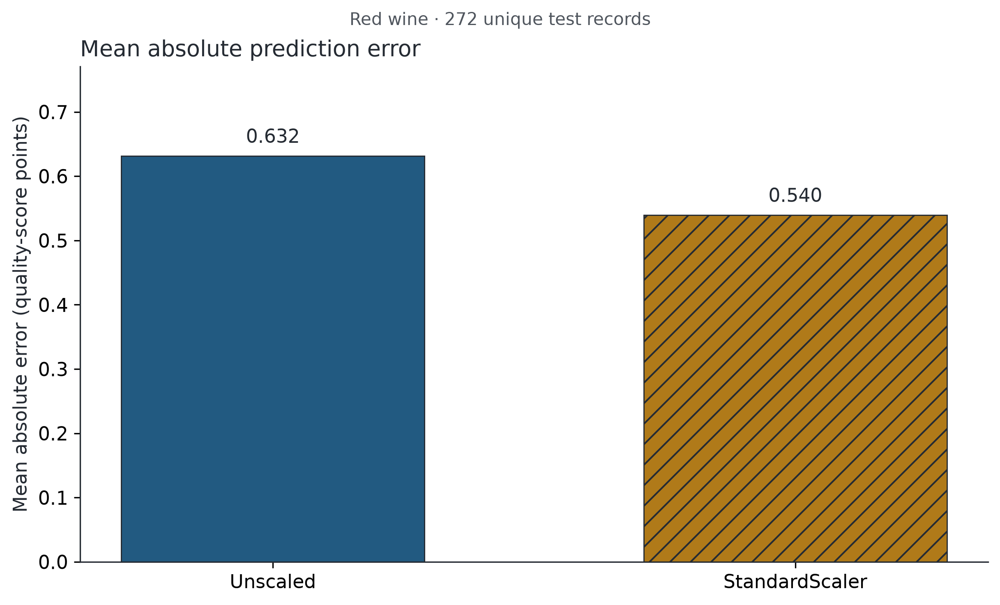
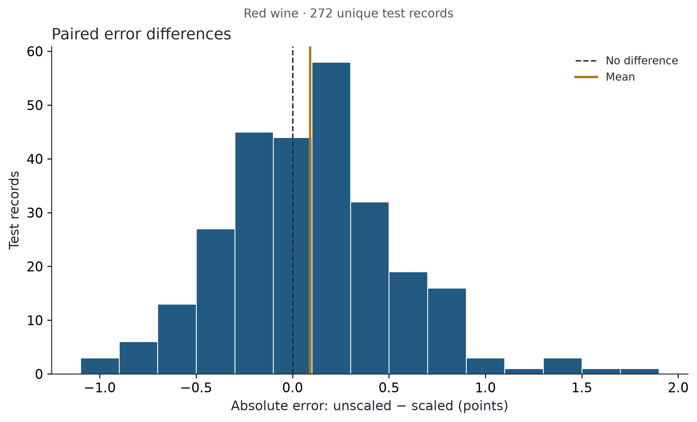
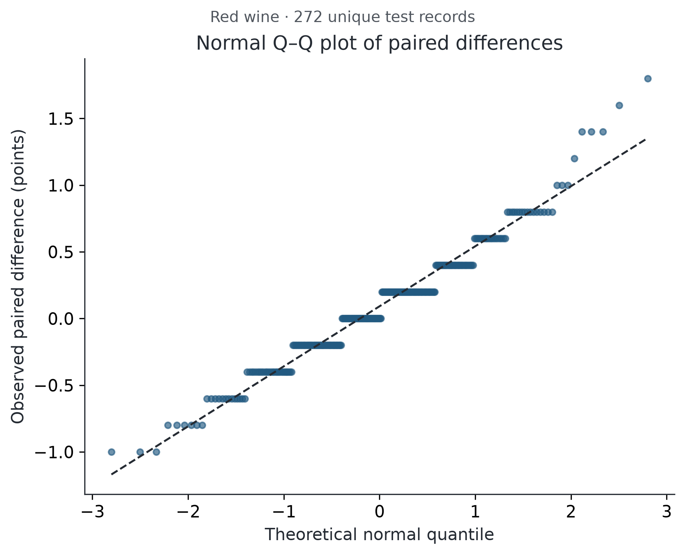
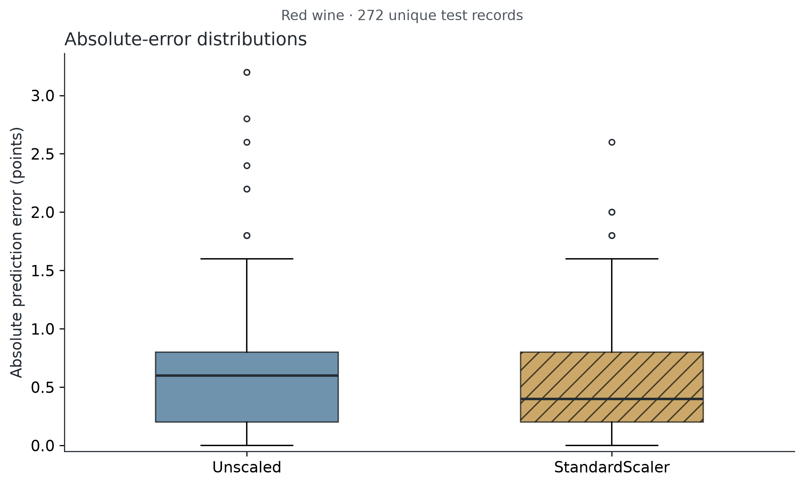
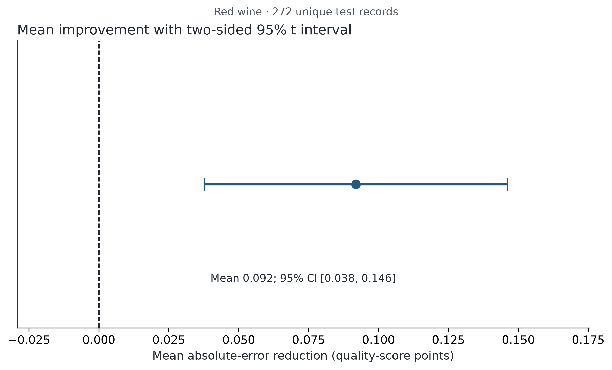
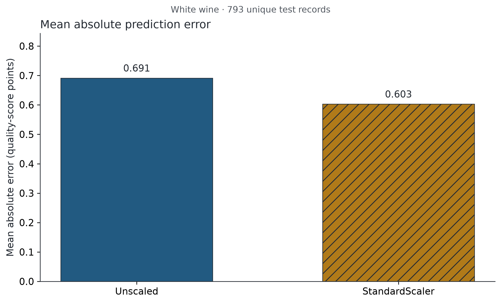
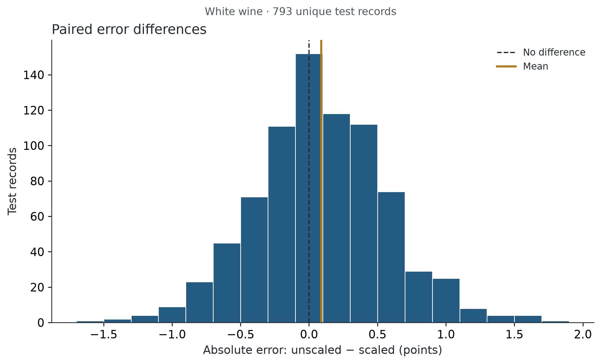
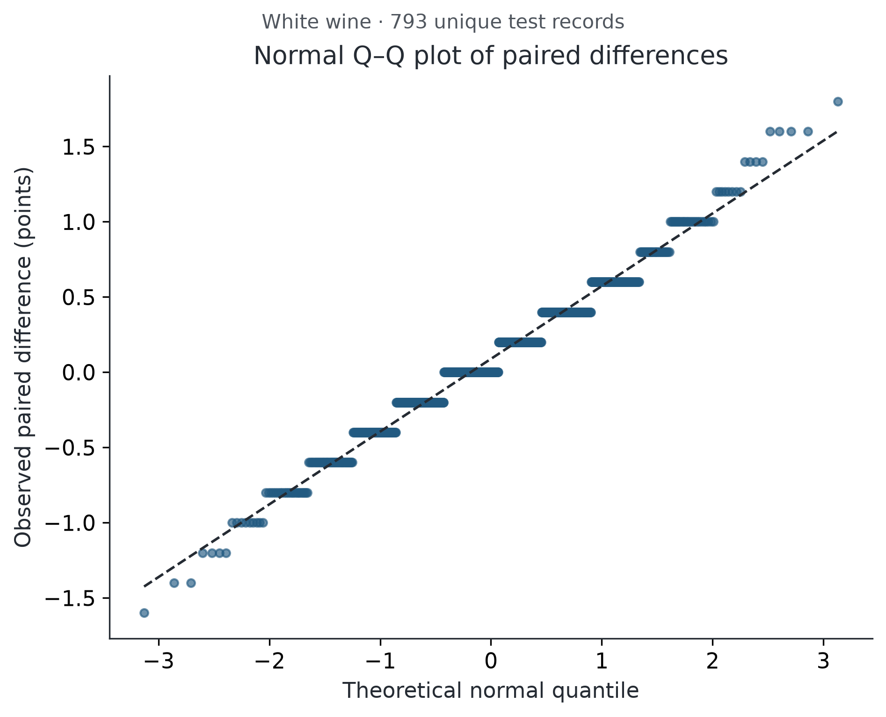
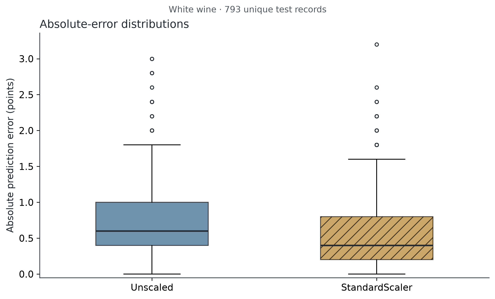
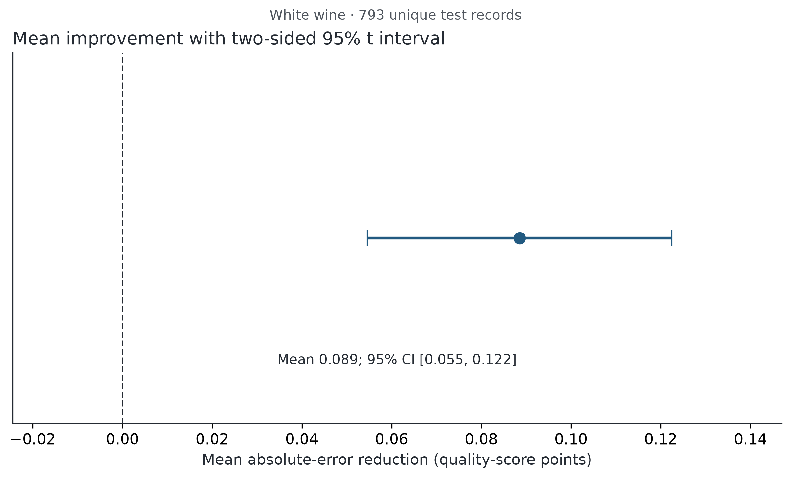

# Feature scaling and KNN wine-quality regression

## Background and research question

Does standardizing the 11 physicochemical predictors reduce KNN regression
absolute prediction error? Wine quality is an ordinal expert score treated as
numeric for this course experiment. KNN uses distances, so predictors measured
on very different scales can dominate neighbor selection. Standardization is
a plausible intervention; its benefit is an empirical question, not a guarantee.

The primary cohort is red Portuguese Vinho Verde wine. White wine, when present,
is a separate secondary replication from the same UCI source. Neither cohort is
pooled with the other. The analysis follows the [prospective project plan](analysis_plan.md),
committed before model evaluation; it is not an external preregistration.

## Hypotheses and experimental design

For a test wine, d = |y − prediction_unscaled| − |y − prediction_scaled|.
H0: μd ≤ 0; H1: μd > 0. Positive values favor scaling. The primary endpoint is
MAE and the primary test is a one-sided paired t-test at α = .05. RMSE is
descriptive. Each retained test observation contributes exactly one pair.

Both arms use the same unstratified 80/20 shuffled split (seed 42), training
order, 11 predictors, and KNeighborsRegressor with k=5, uniform weights,
Euclidean distance, brute-force neighbor search and one computational worker.
The treatment adds only StandardScaler, fitted inside a pipeline on training
predictors. The quality target is never scaled, and predictions stay continuous.
There is no tuning, seed selection, feature selection or outlier deletion.

Remove exact duplicates across predictors and quality before splitting, retaining
the first source record. Both supplied files have no missing/nonfinite cells or
conflicting labels for identical predictor vectors. Input checks fail visibly
if that changes. Deduplication prevents exact copies from straddling the split;
it also changes the estimand to unique recorded profiles. Raw copies, cleaned
records, duplicate mappings and train/test source IDs are saved.

## Statistical methods and assumptions

Let n be test pairs and sd the sample SD of d, with ddof=1. Compute SE=sd/√n,
t=mean(d)/SE, df=n−1, and the right-tail p-value. Observed Cohen's dz=mean(d)/sd
describes the standardized paired effect; it is separate from the assumed
planning dz=.20. A two-sided 95% t interval uses t(.975,df). The additional
one-sided 95% lower bound uses t(.95,df) and corresponds to the .05 directional
test. A two-sided 95% interval can contain zero even if the directional test rejects.

The paired t-test does not require the two arms to have equal error variances
or either error distribution to be normal. Its exact small-sample validity
requires independent, normally distributed differences. Here differences are
bounded and discrete, with ties. Histogram, Q–Q plot, skewness, kurtosis and
Shapiro–Wilk are diagnostics, not gates for choosing a more favorable test.
The CLT supports an approximation with sufficiently many independent pairs,
but diagnostics cannot establish independence. The reported inferential
uncertainty is conditional on this fitted training set and assumes test wines
represent independent draws from a relevant population, not merely a fixed
finite set. We use no finite-population correction for this superpopulation aim.

A prespecified paired percentile bootstrap (10,000 row resamples, seed 4242)
provides a descriptive 95% interval for the same mean. It shares the independence
assumption and is not independent confirmation. Wilcoxon is omitted: a symmetric
location-shift interpretation is unestablished, and tied/zero differences need
care. Its null is not the requested mean-difference null.

## A priori power analysis

Before model evaluation, statsmodels TTestPower.solve_power was called with
effect_size=.20, alpha=.05, power=.80 and alternative='larger'. The small paired
effect dz=.20 is supplied as a planning assumption, not estimated from final
test errors. Required n is rounded upward. This normal-difference planning
model assumes independent pairs; it does not promise power for smaller effects
or establish practical importance. No observed power is calculated.

## Results at a glance

- **Red**: MAE 0.6316 → 0.5397; mean paired reduction 0.0919 points (two-sided 95% CI [0.0377, 0.1462]); one-sided p=0.000485786. Reject H0 at .05.
- **White**: MAE 0.6913 → 0.6028; mean paired reduction 0.0885 points (two-sided 95% CI [0.0546, 0.1224]); one-sided p=1.87593e-07. Reject H0 at .05.

## Primary red-wine experiment

### Data and planning

1,599 raw records − 240 exact duplicates =
1,359 retained records; 1,087 train and 272 test.
Missing cells: 0; conflicting predictor profiles: 0.
The power solver gives 155.9257 pairs, rounded up to
**156 pairs**. The test set of 272 is
sufficient for .80
power at the assumed dz=.20. Model-based design power at that assumption is
0.9501. This was saved before evaluation.

### Results

| Model | MAE (quality-score points) | RMSE (quality-score points) |
| --- | ---: | ---: |
| Unscaled KNN | 0.631618 | 0.821852 |
| StandardScaler + KNN | 0.539706 | 0.712906 |

| Paired inference | Value |
| --- | ---: |
| Test pairs | 272 |
| Mean difference, unscaled − scaled | 0.091912 |
| SD of differences | 0.454507 |
| SE of mean difference | 0.027559 |
| t-statistic | 3.335149 |
| Degrees of freedom | 271 |
| One-sided p-value | 0.00048578577 |
| Two-sided 95% t interval | [0.037656, 0.146168] |
| One-sided 95% lower confidence bound | 0.046427 |
| Observed Cohen's dz | 0.202223 |
| Paired bootstrap 95% percentile interval | [0.038235, 0.145588] |

**Reject H0 at α=.05.** The prespecified directional test provides evidence that scaling reduces mean absolute error for this fixed comparison.
The observed MAE change is 0.0919 score points, or 14.55%
of control MAE. No smallest practically meaningful improvement was specified;
statistical significance alone cannot determine educational or operational value.

Bars start at zero and describe test MAE; uncertainty about the paired contrast
appears in the dedicated mean-improvement interval below.

### Difference distribution and assumptions

There are 134 improvements, 94 deteriorations,
and 44 ties (ties counted with numerical rounding to 10 decimal
places only for diagnostics). Differences range from -1.000 to 1.800;
Q1=-0.200, median=0.000, Q3=0.400.
Skewness=0.4387; excess kurtosis=0.9052.
Shapiro–Wilk W=0.9687, p=1.17445e-05
(descriptive, not a second primary hypothesis or a selection rule).
Normality is not supported at the .05 diagnostic level; discreteness and visible tail departures should be considered.

The paired differences are bounded because quality and uniform-neighbor
predictions remain in the score range. With 272 pairs, t inference is an
approximation justified by the mean's sampling behavior if records are
independent, rather than by exact normality of individual differences.
Deleting any single pair changes the mean to a value between 0.085609
and 0.095941; this is an influence diagnostic, not a reason to delete rows.
The bootstrap interval [0.0382, 0.1456] shows the descriptive sensitivity
of the mean interval to the normal-based calculation, while retaining the
same fixed training set and independence limitation.

Positive values favor scaling; the dashed line is no difference. The .2-point
lattice follows from integer targets and uniform k=5 predictions.

Step patterns are expected for discrete differences; tail departures qualify
the normal-difference assumption. This plot does not test record independence.

Boxes show medians and interquartile ranges, whiskers extend to 1.5 IQR and
points show observations beyond the whiskers (overlapping points may coincide).
They show observation spread, not confidence intervals. The arms are paired.

The dot and bar show mean d and a **two-sided 95% Student t interval** in score
points, conditional on the fitted training set. Positive d favors scaling.

## Secondary white-wine replication

### Data and planning

4,898 raw records − 937 exact duplicates =
3,961 retained records; 3,168 train and 793 test.
Missing cells: 0; conflicting predictor profiles: 0.
The power solver gives 155.9257 pairs, rounded up to
**156 pairs**. The test set of 793 is
sufficient for .80
power at the assumed dz=.20. Model-based design power at that assumption is
1.0000. This was saved before evaluation.

### Results

| Model | MAE (quality-score points) | RMSE (quality-score points) |
| --- | ---: | ---: |
| Unscaled KNN | 0.691299 | 0.872011 |
| StandardScaler + KNN | 0.602774 | 0.783177 |

| Paired inference | Value |
| --- | ---: |
| Test pairs | 793 |
| Mean difference, unscaled − scaled | 0.088525 |
| SD of differences | 0.486465 |
| SE of mean difference | 0.017275 |
| t-statistic | 5.124467 |
| Degrees of freedom | 792 |
| One-sided p-value | 1.8759256e-07 |
| Two-sided 95% t interval | [0.054615, 0.122435] |
| One-sided 95% lower confidence bound | 0.060077 |
| Observed Cohen's dz | 0.181975 |
| Paired bootstrap 95% percentile interval | [0.055233, 0.123077] |

**Reject H0 at α=.05.** The prespecified directional test provides evidence that scaling reduces mean absolute error for this fixed comparison.
The observed MAE change is 0.0885 score points, or 12.81%
of control MAE. No smallest practically meaningful improvement was specified;
statistical significance alone cannot determine educational or operational value.

Bars start at zero and describe test MAE; uncertainty about the paired contrast
appears in the dedicated mean-improvement interval below.

### Difference distribution and assumptions

There are 375 improvements, 266 deteriorations,
and 152 ties (ties counted with numerical rounding to 10 decimal
places only for diagnostics). Differences range from -1.600 to 1.800;
Q1=-0.200, median=0.000, Q3=0.400.
Skewness=0.0903; excess kurtosis=0.5144.
Shapiro–Wilk W=0.9821, p=2.95368e-08
(descriptive, not a second primary hypothesis or a selection rule).
Normality is not supported at the .05 diagnostic level; discreteness and visible tail departures should be considered.

The paired differences are bounded because quality and uniform-neighbor
predictions remain in the score range. With 793 pairs, t inference is an
approximation justified by the mean's sampling behavior if records are
independent, rather than by exact normality of individual differences.
Deleting any single pair changes the mean to a value between 0.086364
and 0.090657; this is an influence diagnostic, not a reason to delete rows.
The bootstrap interval [0.0552, 0.1231] shows the descriptive sensitivity
of the mean interval to the normal-based calculation, while retaining the
same fixed training set and independence limitation.

Positive values favor scaling; the dashed line is no difference. The .2-point
lattice follows from integer targets and uniform k=5 predictions.

Step patterns are expected for discrete differences; tail departures qualify
the normal-difference assumption. This plot does not test record independence.

Boxes show medians and interquartile ranges, whiskers extend to 1.5 IQR and
points show observations beyond the whiskers (overlapping points may coincide).
They show observation spread, not confidence intervals. The arms are paired.

The dot and bar show mean d and a **two-sided 95% Student t interval** in score
points, conditional on the fitted training set. Positive d favors scaling.

## Limitations

- **Unobserved dependence:** no wine/batch/producer identifiers are available.
  Deduplication removes exact overlap but cannot rule out related or near-identical
  wines. Positive within-batch dependence could make SEs too small and nominal
  power too optimistic. We cannot repair unknown clustering with these files.
- **One fitted training set:** the interval and test reflect paired test-wine
  variation, not variation across new training sets. Pooling repeated holdout or
  cross-validation predictions as independent wines would be invalid.
- **Scope and selection:** only one fixed k, distance rule, split and pair of
  preprocessing choices are evaluated. Neither cohort is a random sample of all
  wines; unique profiles and red Vinho Verde define a narrower target. The white
  cohort comes from the same source and differs in chemistry and score mix.
- **Outcome measurement:** expert scores are ordinal, imbalanced and noisy.
  MAE assumes adjacent score steps are comparable. Treating quality as numeric
  is an explicit modeling convention; an improved MAE is not a causal change in
  wine quality or a sensory-treatment effect.
- **Discreteness and tails:** exact normality of differences is unlikely. Large
  sample t inference and the row bootstrap are approximate and both assume
  independent test records. No robustness diagnostic resolves unobserved batches.
- **Practical meaning and multiplicity:** no practical-equivalence margin was
  specified. Red is the only confirmatory .05 test; white is secondary, RMSE is
  descriptive, and diagnostics are not additional evidence for the primary claim.

## Conclusions and reproducibility

The results above answer the prespecified directional question for these fixed
model comparisons. Interpret the measured mean reduction and interval together
with the rejection decision. Do not infer universal benefit, absence of benefit
from nonrejection, or guaranteed performance for new training samples.
Future work could use genuinely identified independent wines/batches and a
separately planned training-sample replication to address the main limitations.

See [README](../README.md) for commands and [analysis plan](analysis_plan.md)
for choices recorded before evaluation. Each `results/<color>/` folder includes
predictions with source IDs and both absolute errors, split memberships,
duplicate mapping, metrics, inference, data audit, scaler means/scales, power
plan and evaluation manifest. The manifest records file hashes, Python/package
versions and event times; byte-level reproducibility of image metadata across
operating systems is not assumed. Numeric results are reproducible with the
locked software environment; repeated runs do not add new independent evidence.

## Sources and technical references

- Cortez et al. (2009), [Wine Quality dataset, UCI](https://archive.ics.uci.edu/dataset/186/wine+quality),
  [dataset DOI](https://doi.org/10.24432/C56S3T). The local `winequality.names`
  documents predictor definitions, expert scoring and data provenance.
- Cortez et al. (2009), *Modeling wine preferences by data mining from
  physicochemical properties*, Decision Support Systems 47(4), 547–553.
  [Article DOI](https://doi.org/10.1016/j.dss.2009.05.016).
- [statsmodels TTestPower.solve_power](https://www.statsmodels.org/stable/generated/statsmodels.stats.power.TTestPower.solve_power.html)
  supports one-sample/paired standardized-effect planning with alternative='larger'.
- [SciPy paired t-test](https://docs.scipy.org/doc/scipy/reference/generated/scipy.stats.ttest_rel.html)
  documents the directional paired test, degrees of freedom and confidence intervals.
- [SciPy Wilcoxon documentation](https://docs.scipy.org/doc/scipy/reference/generated/scipy.stats.wilcoxon.html)
  explains the symmetry null and numerical ties; the default analysis omits it.
